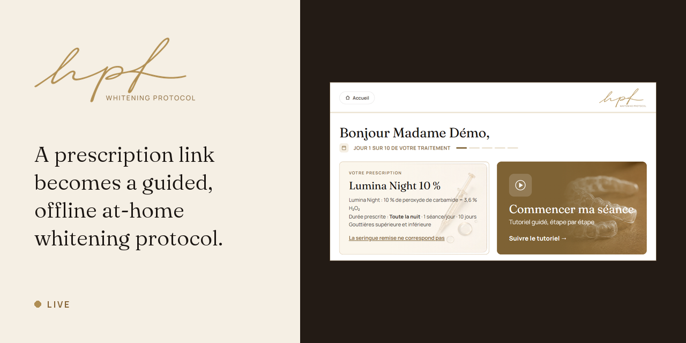

# HPF Whitening Protocol

> A prescription link becomes a guided, offline at-home whitening protocol for the patient.

**Status** · Live &nbsp;·&nbsp; **Area** · Clinical & Patient Experience &nbsp;·&nbsp; **Source code** · private, documentation only

### At a glance

- The patient is guided day by day, without an account.
- No server ever receives the prescription.
- Works offline once installed.

## The problem

At-home whitening is followed alone for days, with wear times to respect and sensitivity to watch.  
The paper instructions get lost, and the patient has nobody to ask in the evening.  

## The solution

The practitioner generates a link; the patient opens an installable, offline, step-by-step whitening guide, with no account, no server and no data transfer.

## My role

Product design and development.  
The project started from the questions patients ask during at-home whitening.

## Key features

- Practitioner link generator with a QR code.
- Prescription carried in the link and strictly validated on opening, with optional expiry.
- Guided protocol step by step, wear timer and night mode.
- Sensitivity check-in after each session and a progress log.
- Voluntary, reversible stop and a help centre for common situations.
- Works offline once installed.

## Screenshots

All screenshots use demonstration or synthetic data.

Practitioner link generator · fictitious patient and product

Patient home screen · fictitious patient and product

## Technologies

HTML · CSS · JavaScript · PWA · Service worker · Netlify

## Architecture

- Vanilla HTML, CSS and JavaScript, with no framework and no backend.
- A service worker caches the app so it opens without a connection.
- Fonts are self-hosted: the app makes no third-party request.

## Development status

- Live as a static web app.

## Privacy and code availability

- No account and no tracking: the data stays on the patient's device.
- Strict input validation, expiring links and an exact-origin check on the return link.
- Honest limit: the link carries the prescription, so it must be treated as confidential.
- The source code of HPF Whitening Protocol is proprietary and kept in a private repository.
- This repository contains documentation and demonstration screenshots only.
- Demonstrations can be arranged on request.

---

[Hugo Philippe Fusaro](https://github.com/hugophilippefusaro) · [HPF Dental Solutions](https://github.com/hpfdentalsolutions) · [hpfdentalsolutions.com](https://hpfdentalsolutions.com)  
© 2026 Hugo Philippe Fusaro. All rights reserved on texts and images.
